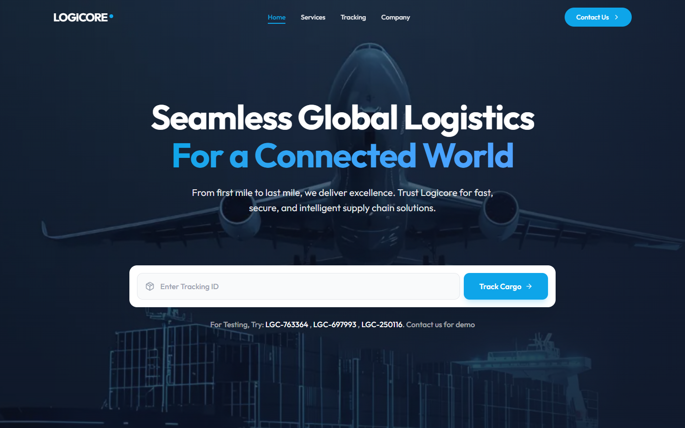
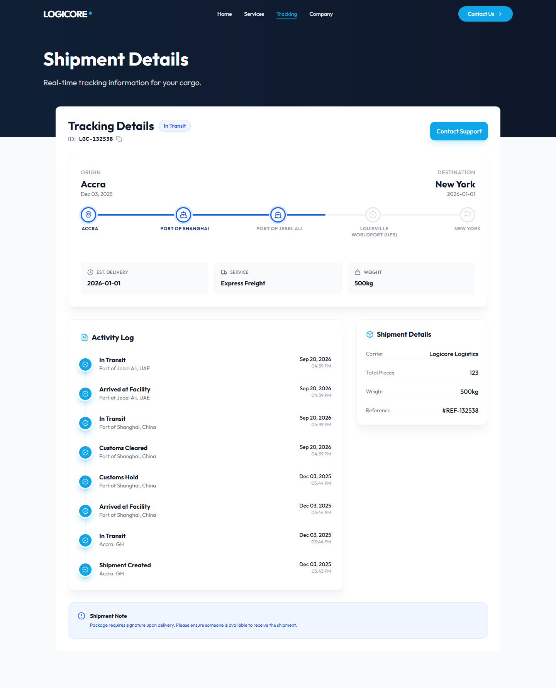
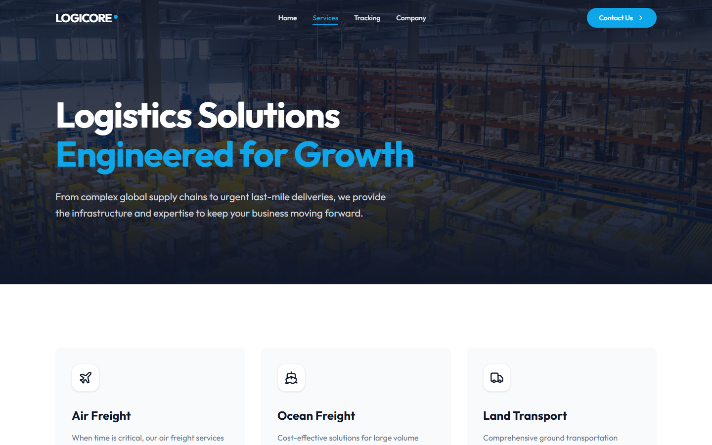
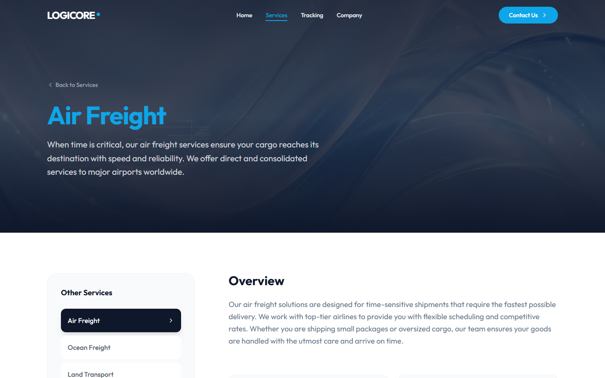
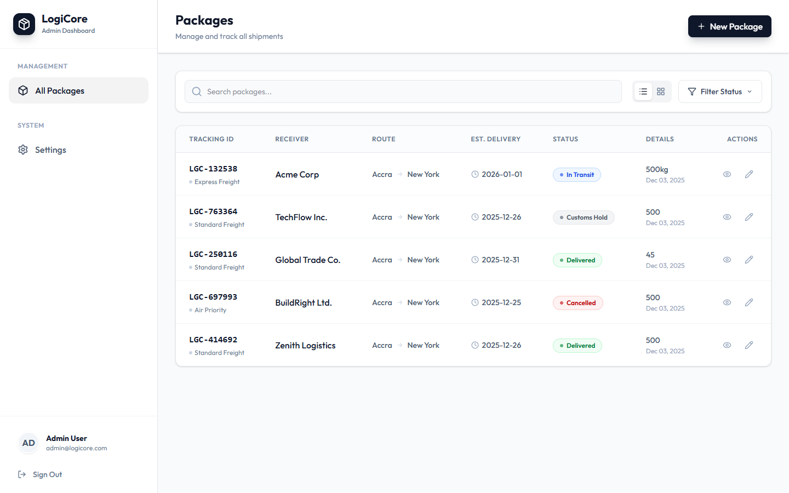
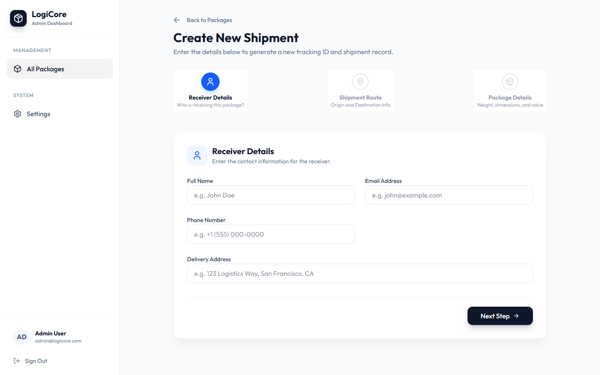
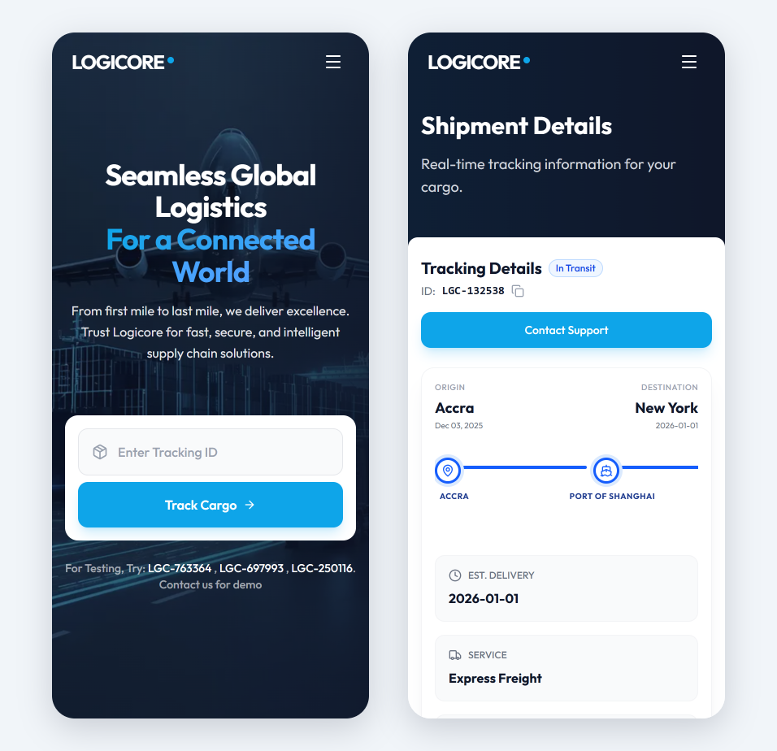
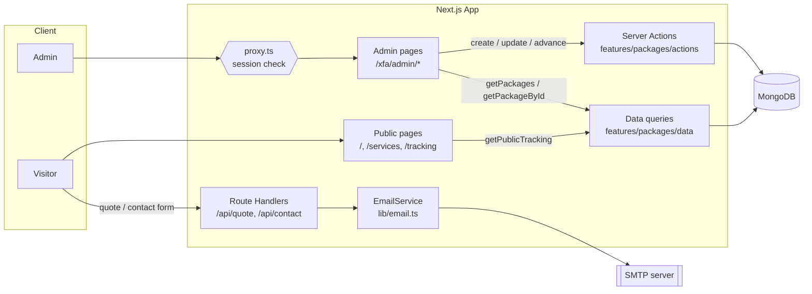
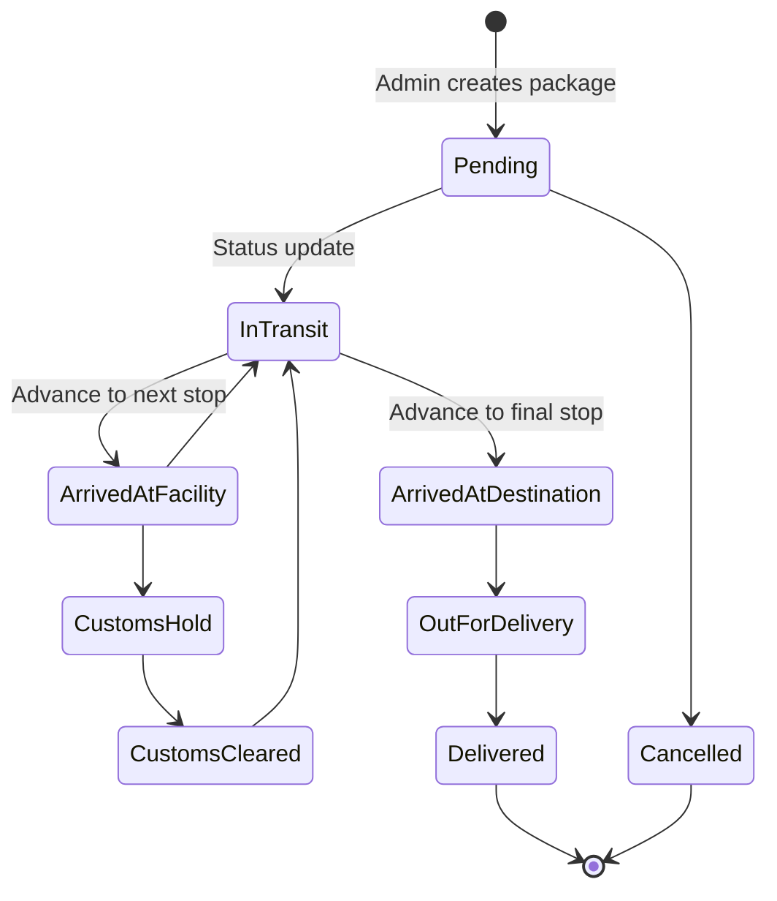

# LogiCore

### A logistics company website with live shipment tracking and an admin console for managing packages.


[](https://logicore-psi.vercel.app)

**🌐 Live demo:** [logicore-psi.vercel.app](https://logicore-psi.vercel.app). Try the tracking IDs `LGC-132538`, `LGC-763364` or `LGC-250116`.



---

## Table of contents

- [What is LogiCore?](#what-is-logicore)
- [Screenshots](#screenshots)
- [Features](#features)
- [Tech stack](#tech-stack)
- [System architecture](#system-architecture)
- [The shipment lifecycle](#the-shipment-lifecycle)
- [Routes](#routes)
- [Repository layout](#repository-layout)
- [Getting started](#getting-started)
- [Environment configuration](#environment-configuration)
- [Deployment](#deployment)
- [Documentation index](#documentation-index)
- [Security](#security)
- [Author](#author)
- [License](#license)

---

## What is LogiCore?

LogiCore is the website for a fictional global freight company. It does three jobs:

1. **Marketing site.** Service pages (air, ocean, land, warehousing, customs brokerage and supply chain), a company page, testimonials, and quote and contact forms that email the support inbox.
2. **Public tracking.** Anyone with a tracking ID (for example `LGC-882910`) can see a shipment's status, progress bar, planned route and event timeline.
3. **Admin console.** Staff sign in, create packages, plan multi-stop routes, and move each shipment along its route. Every change appears on the public tracking page straight away.

---

## Screenshots

**Public tracking.** Planned route with the active stop, the event timeline, and shipment details.



**Services.** A services overview and a detail page for each service.

| Services overview | Service detail |
| --- | --- |
|  |  |

**Admin console.** A package list with search, status filter and table/grid views, plus a three-step form for new shipments. *(Receiver names are anonymised in this screenshot.)*

| Package list | New shipment |
| --- | --- |
|  |  |

**Mobile.** Every page is fully responsive.



---

## Features

**📦 Package management.** A three-step form (receiver details, package details, shipment route) creates a package with a generated `LGC-XXXXXX` tracking ID. Packages can be searched by tracking ID or receiver name, filtered by status, and shown as a table or a grid.

**🗺️ Route-based tracking.** Each package has a planned route: origin, any number of intermediate hubs (picked from a list of major airports, ports and carrier hubs), and destination. Progress is worked out from how far along the route the package is, not set by hand.

**🕒 Event timeline.** Each status update adds a timestamped event at the current stop. The newest event is marked as current.

**✉️ Email notifications.** Quote and contact submissions are validated with Zod, rendered with Handlebars templates, and sent over SMTP with Nodemailer. Contact emails include a section specific to the chosen subject (tracking, partnership, billing, issue report or careers).

**🔐 Protected admin area.** Admins sign in with a password checked on the server and get a signed, httpOnly session cookie. Every admin page, data query and server action checks that session.

**🎨 Polished UI.** Responsive layouts, Framer Motion animations, a navy and sky-blue design system, and a `/style-guide` page that documents it.

---

## Tech stack

| Tier       | Technology                                   | Notes                                                   |
| ---------- | -------------------------------------------- | ------------------------------------------------------- |
| Framework  | Next.js 16 (App Router), React 19            | Server Components plus Server Actions for data writes   |
| Language   | TypeScript 5                                 | Strict typing across UI, actions and models             |
| Styling    | Tailwind CSS 4, `clsx`, `tailwind-merge`     | Design tokens defined in `app/globals.css`              |
| Animation  | Framer Motion                                | Page and component transitions                          |
| Forms      | React Hook Form, Zod 4, `@hookform/resolvers` | The same schemas validate on the client and the server |
| Database   | MongoDB with Mongoose 9                      | Connection cached across hot reloads                    |
| Email      | Nodemailer, Handlebars                       | HTML templates live in `templates/`                     |
| Icons      | Lucide React                                 |                                                         |

---

## System architecture



- **Package reads** go through `features/packages/data/queries.ts`. That's a plain server module, not a `"use server"` file, so the queries can't be called from the browser. Admin queries require a session. The public tracking query returns only what the tracking page shows, never the receiver's contact details.
- **Package writes** go through Server Actions in `features/packages/actions/`. Each one checks the admin session first, then calls `revalidatePath` so the admin pages and tracking pages refresh.
- **Form submissions** go to Route Handlers in `app/api/`. These validate the body with the shared Zod schema, then pass it to the `EmailService` singleton.
- **If SMTP isn't configured**, the email service logs a warning and skips sending instead of crashing, so the site still works locally without email.

---

## The shipment lifecycle



Admins control a shipment with two actions:

| Action                  | What it does                                                                                                                                      |
| ----------------------- | ------------------------------------------------------------------------------------------------------------------------------------------------- |
| **Update status**       | Sets a new status (for example *In Transit* or *Customs Hold*) and logs a timeline event at the current stop.                                       |
| **Advance to next stop** | Moves the active marker to the next stop in `plannedRoute` and sets the status to *Arrived at Facility*, or *Arrived at Destination* at the last stop. |

**How progress is calculated.** Each leg of the route counts for `100 / (stops - 1)` percent. Some statuses add part of the next leg: *In Transit* adds 50%, *Customs Cleared* 30% and *Customs Hold* 20%. A package halfway along a four-stop route always shows the same progress, however many events it has logged.

---

## Routes

| Route                                  | Access | Purpose                                         |
| -------------------------------------- | ------ | ----------------------------------------------- |
| `/`                                    | Public | Home: hero, services, why us, testimonials, quote form |
| `/services`, `/services/[slug]`        | Public | Service overview and detail pages               |
| `/company`                             | Public | Company story and values                        |
| `/contact`                             | Public | Contact form                                    |
| `/tracking`, `/tracking/[trackingId]`  | Public | Tracking search and shipment detail             |
| `/style-guide`                         | Public | Design system reference                         |
| `/privacy`, `/terms`                   | Public | Legal pages                                     |
| `/xfa/admin/login`                     | Public | Admin sign-in                                   |
| `/xfa/admin/packages`                  | Admin  | Package list with search and status filter      |
| `/xfa/admin/packages/new`              | Admin  | Create a package                                |
| `/xfa/admin/packages/[id]`             | Admin  | Package detail                                  |
| `/xfa/admin/packages/[id]/edit-details` | Admin | Edit receiver, package details and route        |
| `/xfa/admin/packages/[id]/edit-tracker` | Admin | Update status and advance the route             |
| `POST /api/quote`                      | API    | Quote request: validate and email               |
| `POST /api/contact`                    | API    | Contact inquiry: validate and email             |
| `GET /api/seed`                        | Dev only | Clears and reseeds the packages collection. Returns 404 outside `npm run dev` |

---

## Repository layout

```
logicore/
├── app/                     # Next.js App Router: pages, layouts, route handlers
│   ├── api/                 # quote, contact, seed endpoints
│   ├── services/            # service listing + [slug] detail
│   ├── tracking/            # tracking search + [trackingId] detail
│   └── xfa/admin/           # admin login + package management
├── features/                # Feature-sliced modules
│   ├── auth/                # login / logout server actions
│   ├── packages/            # data queries, actions, schemas, admin UI + form steps
│   ├── tracking/            # tracking hero, details, FAQ
│   ├── homepage/            # hero, services, quote form + schema
│   ├── contact/             # contact form + schema
│   ├── company/             # company page sections
│   ├── services/            # service data + page sections
│   └── shared/              # navbar, footer, search, api() fetch wrapper
├── lib/
│   ├── auth/                # Session tokens, cookies, requireAdmin()
│   ├── db/connect.ts        # Cached Mongoose connection
│   ├── db/models/           # Package model
│   └── email.ts             # EmailService (Nodemailer + Handlebars)
├── templates/               # HTML email templates
├── docs/screenshots/        # README screenshots
├── public/                  # Images, favicon, OG image
└── proxy.ts                 # Redirects signed-out visitors away from /xfa/admin/*
```

Each folder in `features/` keeps its own `ui/`, `actions/` and `schema/`. Code for one domain stays together instead of being spread across global `components/` and `utils/` folders.

---

## Getting started

### Prerequisites

- Node.js 20 or newer
- A MongoDB database: local, Docker, or [MongoDB Atlas](https://www.mongodb.com/atlas)
- *(Optional)* SMTP credentials if you want the forms to send email

### 1. Clone

```bash
git clone https://github.com/FosterSOAsare/logicore.git
cd logicore
```

### 2. Install

```bash
npm install
```

### 3. Configure

```bash
cp .env.example .env
```

Fill in `MONGODB_URI`, `ADMIN_PASSWORD` and `SESSION_SECRET`, plus the SMTP variables if you want email. See [Environment configuration](#environment-configuration).

Generate a session secret with:

```bash
openssl rand -hex 32
```

### 4. Run

```bash
npm run dev
```

Open [http://localhost:3000](http://localhost:3000). The admin console is at [http://localhost:3000/xfa/admin/login](http://localhost:3000/xfa/admin/login). Sign in with your `ADMIN_PASSWORD`.

### Scripts

| Command         | Description                  |
| --------------- | ---------------------------- |
| `npm run dev`   | Start the dev server         |
| `npm run build` | Create a production build    |
| `npm run start` | Serve the production build   |
| `npm run lint`  | Run ESLint                   |

---

## Environment configuration

| Variable        | Required | Purpose                                                                |
| --------------- | -------- | ---------------------------------------------------------------------- |
| `MONGODB_URI`   | Yes      | MongoDB connection string                                              |
| `ADMIN_PASSWORD` | Yes     | Password for the admin console                                         |
| `SESSION_SECRET` | Yes     | At least 32 random characters, used to sign admin session cookies. Changing it signs everyone out |
| `SMTP_HOST`     | For email | SMTP server host                                                      |
| `SMTP_PORT`     | For email | SMTP port. `465` turns on implicit TLS; other ports use STARTTLS       |
| `SMTP_USER`     | For email | SMTP username                                                         |
| `SMTP_PASSWORD` | For email | SMTP password or app password                                         |
| `EMAIL_FROM`    | For email | Sender address on outgoing notifications                              |
| `SUPPORT_EMAIL` | For email | Inbox that receives quote and contact notifications                   |

If `ADMIN_PASSWORD` or `SESSION_SECRET` is missing, admin sign-in stays locked. If any SMTP variable is missing, email is turned off with a console warning and the rest of the app keeps working.

---

## Deployment

| Piece    | Host            | Why                                                        |
| -------- | --------------- | ---------------------------------------------------------- |
| Web app  | Vercel ([live](https://logicore-psi.vercel.app)) | First-class Next.js support, with Server Actions and ISR built in |
| Database | MongoDB Atlas   | Managed MongoDB with a free tier                           |
| Email    | Any SMTP provider (Gmail app password, Resend, SES, Mailgun) | Works with the existing Nodemailer transport |

Set the variables above in your host's dashboard. Because `lib/email.ts` reads templates from `templates/` at runtime, make sure that folder is included in the deployed output.

---

## Documentation index

| Document                                                             | What's inside                                         |
| -------------------------------------------------------------------- | ----------------------------------------------------- |
| [`templates/README.md`](templates/README.md)                         | Email template variables, conditional sections, testing |
| [`features/shared/actions/README.md`](features/shared/actions/README.md) | The typed `api()` / `apiClient` fetch wrapper      |
| [`/style-guide`](app/style-guide/page.tsx)                           | Live design system: colours, type, components         |

---

## Security

The admin area is protected at several levels:

| Layer | Protection |
| --- | --- |
| Sign-in | The password is checked on the server in constant time, with a fixed delay to slow brute-force attempts. It never reaches the client bundle. |
| Session | A signed (HMAC-SHA256) cookie that expires after 8 hours. It is `httpOnly`, `SameSite=Lax`, and `Secure` in production. |
| Routing | `proxy.ts` redirects signed-out visitors away from `/xfa/admin/*`. |
| Data and actions | `requireAdmin()` runs in every admin query and Server Action, so the proxy isn't the only check. |
| Public data | The tracking page receives only shipment fields. Receiver name, email, phone, address and declared value stay on the server. |
| Search | Admin search input is regex-escaped before it reaches MongoDB. |
| Seed route | Returns 404 outside local development. |

If you find a security issue, please email the author instead of opening a public issue.

---

## Author

| Member                        | GitHub                                             |
| ----------------------------- | -------------------------------------------------- |
| Foster Solomon Owusu Asare    | [@FosterSOAsare](https://github.com/FosterSOAsare) |

---

## License

Released under the MIT License.
